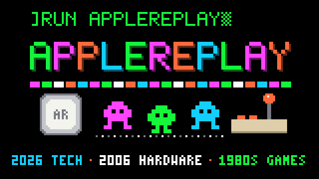

# applereplay



What if a 2006 Apple TV could play the Apple II games of the 1980s, with tools
from 2026?¹

applereplay turns an original Apple TV (first generation, model A1218) into an
Apple II games console. It boots Debian from a USB stick straight into
[linapple](https://github.com/linappleii/linapple), an Apple II emulator,
running [Total Replay](https://github.com/a2-4am/4cade), a collection of
hundreds of Apple II games behind one menu. Plug in a USB keyboard and play,
at full speed, with correct colours and stereo sound over HDMI.

The build is rootless and runs on an ordinary Linux PC. Only writing the USB
stick needs root.

## What you need

- An original Apple TV: the first generation, **model A1218**, sold from 2007
  (the model number is on the underside). It is the silver one, about 8 inches
  (20 cm) square, with an Intel processor and a hard disk inside. **No later Apple TV
  will work:** the small black boxes that followed (second generation
  onwards, including Apple TV HD and 4K) are different, ARM-based machines
  that can't run this at all.
- A TV with HDMI, wired Ethernet (for SSH; optional for playing) and a USB
  keyboard.
- A USB hub, because the Apple TV has a single USB port and it has to take
  both the stick and the keyboard. A powered hub (one with its own power
  supply) is strongly recommended: under USB's rules an unpowered hub may
  pass only 100 mA to each device, and a USB stick can ask for more (the one
  used here asks for 300 mA). An unpowered hub hasn't been tried. A USB 2.0
  hub is enough, since the Apple TV's port is USB 2.0.
- A USB stick of 8 GB or more. The image is 7.0 GB whatever it contains (a
  0.5 GB boot partition and a 6 GB system partition, about a fifth of it
  used); the rest of the stick is left alone. A USB 3.0 stick works, at
  USB 2.0 speed.

  Tried and working together: a powered USB 2.0 hub, a USB 3.0 stick, an
  Apple USB keyboard from a 2006 iMac and a wired Xbox 360 controller.
- Optional: a wired Xbox 360 controller on the hub, for games that used the
  Apple II's joystick. It is the only kind tried; other USB controllers that
  Linux supports may work too. You still need the keyboard for the menu.
- A Linux PC (x86_64) with `mmdebstrap`, `bubblewrap`, `uidmap` and `git`, and
  unprivileged user namespaces enabled. Built and tested on Linux Mint 22
  (Ubuntu 24.04 based); other distributions should work but are untested.
  Writing the stick needs `bmap-tools` and `gdisk`. On Debian, Ubuntu or Mint:

  ```
  sudo apt install mmdebstrap bubblewrap uidmap git openssh-client bmap-tools gdisk
  ```

## Files you get yourself

These aren't ours to redistribute, so they stay out of the repository. Put them
in `assets/`:

- `assets/atv-boot/boot.efi`: Apple's boot loader, from an Apple TV update
  image. See
  [atv-linux-loader's instructions](https://github.com/DistroHopper39B/atv-linux-loader#gather-and-copy-necessary-files-this-should-be-done-on-linux)
  (download `2Z694-6013-013.dmg`, extract
  `OSBoot/System/Library/CoreServices/boot.efi` with `7z`).
- `assets/atv-boot/System/Library/Extensions/Dummy.kext`: from
  [DummyKext's releases](https://github.com/DistroHopper39B/DummyKext/releases).
- `assets/total-replay.hdv`: the Total Replay hard disk image, from
  [Total Replay's releases](https://github.com/a2-4am/4cade/releases). It
  contains commercial games from the 1980s.

`assets.sha256` has the SHA-256 of each file this was built and tested with
(Total Replay 6.1, DummyKext 1.0). The build warns when yours differ; a newer
Total Replay is fine, a damaged download is not. To check by hand:
`sha256sum -c assets.sha256`.

## Build

```
git clone --recurse-submodules https://github.com/arguingbananas/applereplay
cd applereplay
env/bootstrap.sh         # once: a Debian toolchain in env/root (~1 GB)
env/build-cctools.sh     # once: Apple's linker, needed for the boot loader
./build.sh               # 3-5 min: out/rootfs.tar, kernel and initramfs
./mkimage.sh             # out/totalreplay.img, ready to write
```

To change linapple, edit `out/src/linapple` and use `env/devroot build` and
`env/devroot install`: it builds inside a copy of the box's own system on your
PC, in seconds, and puts the result on the box.

`build.sh` makes an SSH key for you in `out/ssh/` and the box's host keys in
`out/hostkeys/`; both survive rebuilds. Keep `out/` private, and don't pass
your image on to anyone: it holds the box's private host keys, lets your key
log in as root, and contains Apple's boot loader and the games, which aren't
yours to redistribute. Others should build their own.

Settings, as environment variables:

| Variable | For | Default |
| --- | --- | --- |
| `TMPDIR` | `build.sh`: where the system is unpacked (about 2 GB) | `/dev/shm` if it has 4 GB free, else `/tmp` |
| `LINAPPLE_REF` | `build.sh`: the linapple commit to build | the tested commit |
| `ROOT_SIZE_MIB` | `mkimage.sh`: size of the root partition | 6144 |
| `TEST_BOX` | `tests/run`: `1` also tests a running Apple TV over SSH | unset |
| `TEST_HOST` | `tests/run`: the Apple TV's SSH address | `apple@applereplay.local` |

## Tests

```
tests/run                # everything that needs no Apple TV, about 1.5 minutes
tests/run static         # one test by name: static, image, stretch, devroot, box
TEST_BOX=1 tests/run     # also checks a running box: services, display and sound setup, 60 fps
```

Tests skip what they can't check yet and say what to run first: most need
`env/bootstrap.sh` and a finished `./build.sh` and `./mkimage.sh`, and the
i386 checks need `env/devroot init`. The shell scripts are checked with
[shellcheck](https://www.shellcheck.net), which `env/bootstrap.sh` installs.

## Write the stick

Check which device the stick is (`lsblk`), then, with `/dev/sdX` replaced:

```
sudo bmaptool copy out/totalreplay.img /dev/sdX
sudo sgdisk -e /dev/sdX
```

This erases the stick. Put it in the Apple TV and power on: the applereplay
logo, some boot text, then Total Replay.

## Using the box

- **Play:** type to search Total Replay's menu, Return to start a game, `?` for
  help.
- **Leave a game:** Ctrl+F10 (the Apple II's Ctrl-Reset) goes back to Total
  Replay's menu. If a game ignores it, Ctrl+F2 restarts the Apple II, and F12
  quits the emulator, which starts again at the menu. F1 lists every emulator
  key, and Pause pauses. Mind F10 and F11 on their own: they load and save a
  snapshot.
- **Joystick:** with a game controller plugged in when the emulator starts,
  its left stick is the Apple II's joystick and its first two buttons (A and
  B on an Xbox pad) are the Apple II's two. The d-pad works as a stick pushed
  all the way, which suits many games better. With no controller, the
  numeric keypad is the joystick: 1-9 for directions, 0 and `.` for the
  buttons. If you plug a controller in later, press F12 to restart the
  emulator.
- **SSH:** `ssh -i out/ssh/totalreplay_ed25519 apple@applereplay.local`. User
  `apple` has passwordless sudo, so the key is as good as root: keep it safe.
- **Security:** the box is meant for a home network. A firewall lets in only
  SSH, its name on the network (mDNS) and ping. It never updates itself:
  rebuild now and then, or run `sudo apt update && sudo apt upgrade` on it;
  `env/vuln-check` tells you when Debian has fixes your image lacks.
  [SECURITY.md](SECURITY.md) has the details and how to report a problem.
- **A bigger or smaller picture:** if your TV shows the whole picture and you
  want less border, or it crops more than most, put a zoom factor in
  `/etc/totalreplay/screen-factor` (for example
  `echo 1.875 | sudo tee /etc/totalreplay/screen-factor` fills 720 lines) and
  quit the emulator with F12 to restart it. Delete the file to go back to the
  automatic size.
- **A shell instead of the game:** `sudo touch /etc/totalreplay/no-kiosk` and
  reboot (remove the file to go back).
- **Speed check:** `sudo fps` prints linapple's frames per second (60 is full
  speed) and CPU use.
- **Picture and sound tests** for when something looks or sounds wrong:
  `tools/av-test` (colour screens) and `tools/sound-test` (a voice on each
  channel). Copy them to the box and run them while someone watches the TV.

## How it works

- **Boot:** Apple's `boot.efi` loads
  [atv-linux-loader](https://github.com/DistroHopper39B/atv-linux-loader)
  (`mach_kernel`), which starts Debian 12's i386 kernel with an embedded
  initramfs.
- **Picture:** Linux's nouveau driver is turned off. Whenever it sets a
  display mode, the Apple TV's HDMI chip sends colours the TV misreads, and
  everything turns purple. X draws on the 1280x720 screen Apple's firmware
  sets up instead, with write-combining turned on for that memory
  (`applereplay-fb-wc`).
- **Sound:** the HDMI chip never tells Linux a TV is connected, so Linux
  skips the HDMI audio setup. `applereplay-hdmi-audio` turns it on each time
  audio starts.
- **Speed:** three patches in `patches/` let linapple build on 32-bit, scale
  without per-pixel division, and redraw only the rows that changed. On the
  Apple TV's 1 GHz CPU that's 60 fps with about half the CPU free.
- **Size:** the picture is fitted to the screen the Apple TV's firmware sets
  up, leaving a black border of about 7% because many TVs crop the edges
  (overscan): 980x672 on the usual 1280x720. Only that size has been tried on
  a real TV.

`docs/NOTES.md` has the full engineering notes: what was tried, what was
measured and why things are the way they are.

## Working on this with Claude Code

The project was built with [Claude Code](https://claude.com/claude-code), and
it's set up for you to carry on the same way. Open the repository in Claude
Code and it reads `CLAUDE.md`, which loads `docs/NOTES.md`: the hardware
facts, every fix and measurement, the gotchas, and the list of what's next.
Put anything about your own setup (your build machine, your TV, the box's
address) in `CLAUDE.local.md`; Claude Code loads it too, and git ignores it.

## Thanks

applereplay stands on these projects:

- [linapple](https://github.com/linappleii/linapple), the Apple II emulator.
- [Total Replay](https://github.com/a2-4am/4cade) by 4am and qkumba, and the
  authors of every game in it.
- [atv-linux-loader](https://github.com/DistroHopper39B/atv-linux-loader) and
  [DummyKext](https://github.com/DistroHopper39B/DummyKext) by
  DistroHopper39B, which make Linux on the Apple TV possible.
- [Debian](https://www.debian.org), still shipping a 32-bit kernel.

Our fixes to these projects are meant to go back upstream; `docs/NOTES.md` lists
them.

## License

applereplay's own files are under the [MIT License](LICENSE). The linapple
patches in `patches/` change GPL-2.0 code and are offered under linapple's
GPL-2.0, like the program they become part of. atv-linux-loader (a submodule)
is GPL-2.0, and Total Replay is MIT; the games in it belong to their authors.

---

¹ The entire project — concept, specification, and code — was an original human idea written by an artificial intelligence.
